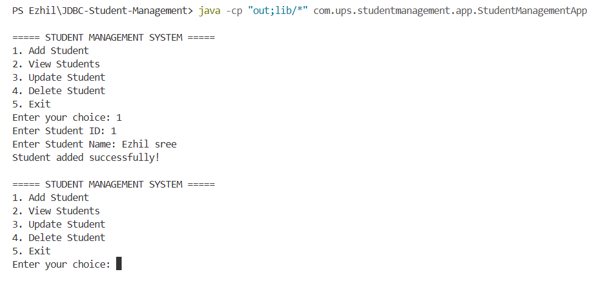
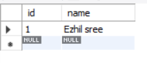

# Day 13 – JDBC and SQL Joins

## Topics Covered

- Java Database Connectivity (JDBC)
- MySQL Database Connection
- JDBC CRUD Operations
- PreparedStatement and ResultSet
- SQL Joins
  - INNER JOIN
  - LEFT JOIN
  - RIGHT JOIN
  - FULL OUTER JOIN
  - CROSS JOIN

---

## 1. Java Database Connectivity (JDBC)

JDBC (Java Database Connectivity) is an API that allows Java applications to connect and interact with databases such as MySQL.

### JDBC Workflow

1. Load the JDBC driver.
2. Establish a database connection.
3. Create a Statement or PreparedStatement.
4. Execute SQL queries.
5. Process the ResultSet.
6. Close database resources.

### JDBC CRUD Operations

| Operation | SQL Command | Description |
|---|---|---|
| Create | INSERT | Add a new student |
| Read | SELECT | Retrieve student records |
| Update | UPDATE | Modify student details |
| Delete | DELETE | Remove a student record |

---

## 2. Database Setup

**Database:** `test`

**Table:** `student`

```sql
create database test;

use test;

create table student (
    id int primary key,
    name varchar(100) not null
);
```

### Insert Sample Data

```sql
insert into student values (1, 'Ezhil sree');
```

### View Student Records

```sql
select * from student;
```

---

## 3. JDBC Student Management System

### Project Description

Developed a console-based Student Management System using Java, JDBC, and MySQL. The application performs CRUD operations to manage student records.

### Technologies Used

- Java
- JDBC
- MySQL
- MySQL Connector/J
- Visual Studio Code

### Project Structure

```text
JDBC-Student-Management/
│
├── lib/
│   └── mysql-connector-j-26.10.0.jar
│
└── src/
    └── com/
        └── ups/
            └── studentmanagement/
                ├── config/
                │   └── DatabaseConnection.java
                ├── model/
                │   └── Student.java
                ├── dao/
                │   └── StudentDAO.java
                ├── service/
                │   └── StudentService.java
                └── app/
                    └── StudentManagementApp.java
```

### Java Source Files

| Package | Java File |
|---|---|
| config | [DatabaseConnection.java](JDBC-Student-Management/src/com/ups/studentmanagement/config/DatabaseConnection.java) |
| model | [Student.java](JDBC-Student-Management/src/com/ups/studentmanagement/model/Student.java) |
| dao | [StudentDAO.java](JDBC-Student-Management/src/com/ups/studentmanagement/dao/StudentDAO.java) |
| service | [StudentService.java](JDBC-Student-Management/src/com/ups/studentmanagement/service/StudentService.java) |
| app | [StudentManagementApp.java](JDBC-Student-Management/src/com/ups/studentmanagement/app/StudentManagementApp.java) |

### Package Responsibilities

| Package | Responsibility |
|---|---|
| config | Establishes the MySQL connection |
| model | Represents student data |
| dao | Handles database CRUD operations |
| service | Contains application logic and validation |
| app | Runs the main application |

### Application Features

1. Add Student
2. View Students
3. Update Student
4. Delete Student
5. Exit Application

### JDBC Connection Configuration

```java
private static final String URL =
    "jdbc:mysql://localhost:3306/test";

private static final String USERNAME = "root";
private static final String PASSWORD = "";
```

Change the password according to your MySQL configuration.

### Compile and Run

**Compile all Java files:**

```powershell
javac -cp "lib/*" -d out (Get-ChildItem -Recurse src -Filter *.java).FullName
```

**Run the application:**

```powershell
java -cp "out;lib/*" com.ups.studentmanagement.app.StudentManagementApp
```

---

## 4. SQL Joins

SQL Joins are used to retrieve related data from multiple tables based on a common column.

### Sample Tables

**Employee Table**

| employee_id | employee_name | department_id |
|---|---|---|
| 1 | Arun | 101 |
| 2 | Priya | 102 |
| 3 | Kavin | 103 |
| 4 | Ezhil | NULL |

**Department Table**

| department_id | department_name |
|---|---|
| 101 | HR |
| 102 | IT |
| 104 | Finance |

### INNER JOIN

Returns only matching records from both tables.

```sql
select employee.employee_name,
       department.department_name
from employee
inner join department
on employee.department_id = department.department_id;
```

### LEFT JOIN

Returns all records from the left table and matching records from the right table.

```sql
select employee.employee_name,
       department.department_name
from employee
left join department
on employee.department_id = department.department_id;
```

### RIGHT JOIN

Returns all records from the right table and matching records from the left table.

```sql
select employee.employee_name,
       department.department_name
from employee
right join department
on employee.department_id = department.department_id;
```

### FULL OUTER JOIN

Returns matching and non-matching records from both tables.

MySQL does not directly support FULL OUTER JOIN. It can be achieved using LEFT JOIN and RIGHT JOIN with UNION.

```sql
select employee.employee_name,
       department.department_name
from employee
left join department
on employee.department_id = department.department_id

union

select employee.employee_name,
       department.department_name
from employee
right join department
on employee.department_id = department.department_id;
```

### CROSS JOIN

Returns the Cartesian product of both tables.

```sql
select employee.employee_name,
       department.department_name
from employee
cross join department;
```

---

## 5. Practical Output

### VS Code – JDBC Student Management System

Successfully executed the Java JDBC application in Visual Studio Code and tested the student management operations.



### MySQL – Student Database

Verified the student records stored in the `student` table of the MySQL `test` database.



---

## 6. Key Learnings

- Understood JDBC architecture and database connectivity.
- Connected a Java application with MySQL using MySQL Connector/J.
- Implemented INSERT, SELECT, UPDATE, and DELETE operations.
- Used PreparedStatement to execute parameterized SQL queries.
- Retrieved database records using ResultSet.
- Understood different types of SQL Joins.
- Organized a Java application using config, model, DAO, service, and app packages.
- Executed and tested a JDBC application using Visual Studio Code.

---

## Conclusion

Successfully developed and executed a Java JDBC Student Management System with MySQL integration and learned different SQL Join operations as part of Day 13 of UPS Java Full Stack Training.