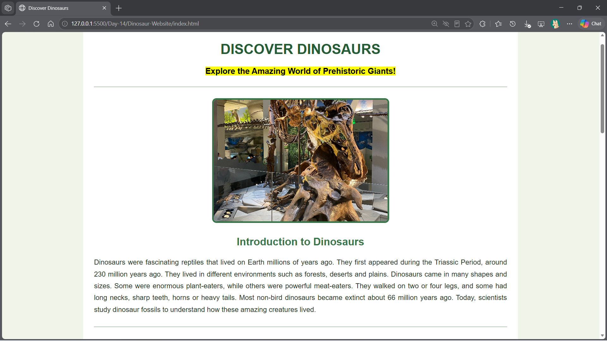
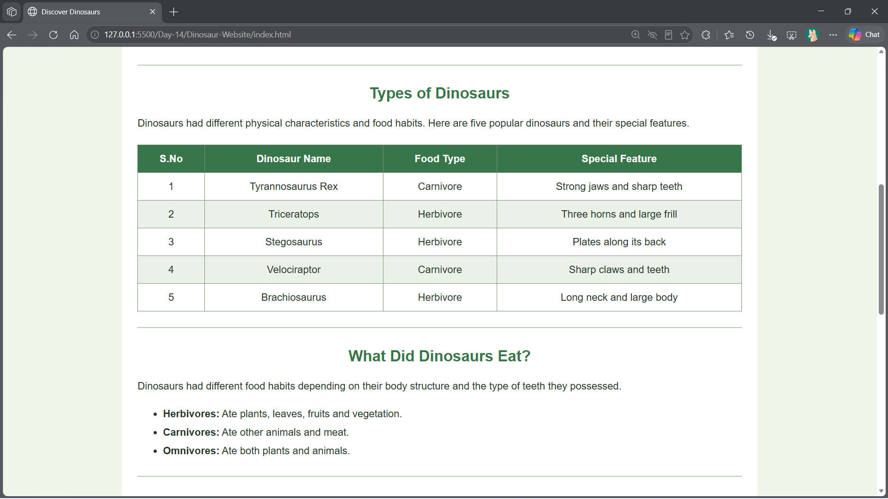
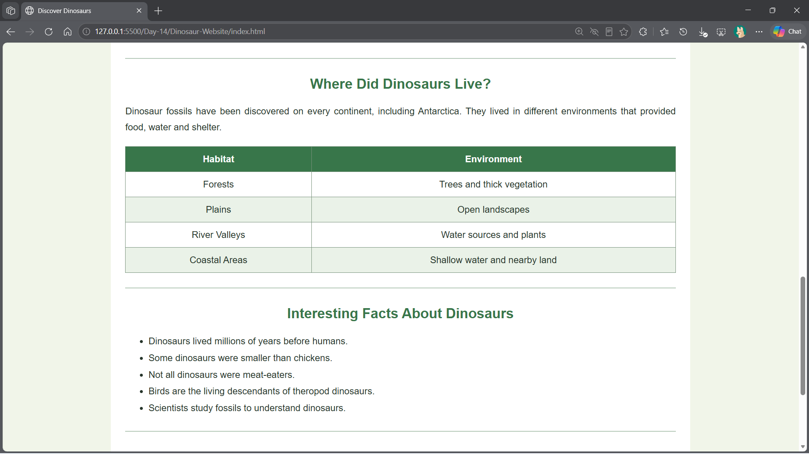
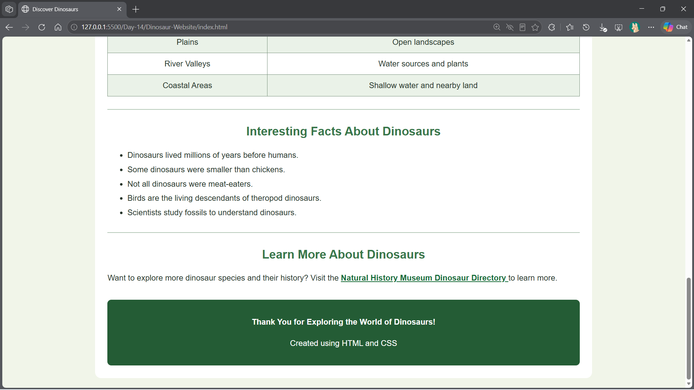

# Day 14 – HTML Fundamentals and Web Page Development

## Topics Covered

- HTML Document Structure
- HTML Headings and Paragraphs
- Text Formatting Tags
- HTML Images and Hyperlinks
- HTML Tables
- Ordered and Unordered Lists
- HTML Attributes
- CSS Styling
- GitHub Pages Deployment

---

## 1. Introduction to HTML

HTML (HyperText Markup Language) is the standard markup language used to create and structure web pages.

It defines the structure of a webpage using elements and tags.

### Basic HTML Structure

```html
<!DOCTYPE html>
<html>
<head>
    <title>My First Webpage</title>
</head>
<body>
    <h1>Hello World</h1>
    <p>Welcome to <mark>Chennai</mark></p>
    <p>HTML is <b>easy</b> and <i>useful</i></p>
    <p>Learn HTML</p>
</body>
</html>
```

### HTML Tags and Their Uses

| HTML Tag | Description |
|---|---|
| `<html>` | Defines the HTML document |
| `<head>` | Contains page metadata |
| `<title>` | Defines the browser tab title |
| `<body>` | Contains visible webpage content |
| `<h1>` to `<h6>` | Defines headings |
| `<p>` | Defines a paragraph |
| `<hr>` | Creates a horizontal line |
| `<br>` | Inserts a line break |
| `<mark>` | Highlights text |
| `<b>` | Displays bold text |
| `<i>` | Displays italic text |

---

## 2. HTML Tables

HTML tables are used to organize information into rows and columns.

### Table Structure

| HTML Tag | Description |
|---|---|
| `<table>` | Creates a table |
| `<thead>` | Groups the table header |
| `<tbody>` | Groups the table body |
| `<tr>` | Creates a table row |
| `<th>` | Defines a header cell |
| `<td>` | Defines a data cell |

### Example: Student Details Table

```html
<table border="2">
    <thead>
        <tr>
            <th>S.No</th>
            <th>Name</th>
            <th>Mobile No</th>
        </tr>
    </thead>

    <tbody>
        <tr>
            <td>1</td>
            <td>Akash</td>
            <td>08979809000</td>
        </tr>

        <tr>
            <td>2</td>
            <td>Priya</td>
            <td>9876543210</td>
        </tr>

        <tr>
            <td>3</td>
            <td>Arun</td>
            <td>9876501234</td>
        </tr>
    </tbody>
</table>
```

---

## 3. HTML Images and Hyperlinks

### Images

The `` tag is used to display images on a webpage.

**Syntax:**

```html

```

| Attribute | Description |
|---|---|
| `src` | Specifies the image path |
| `alt` | Provides alternative text |
| `width` | Sets image width |
| `height` | Sets image height |

### Hyperlinks

The `<a>` tag is used to create hyperlinks to other webpages or websites.

**Example:**

```html
<a href="https://www.example.com" target="_blank">
    Visit Website
</a>
```

- `href` specifies the destination URL.
- `target="_blank"` opens the link in a new tab.

---

## 4. HTML Lists

HTML supports different types of lists to organize information.

### Unordered List

Displays items using bullet points.

```html
<ul>
    <li>HTML</li>
    <li>CSS</li>
    <li>JavaScript</li>
</ul>
```

### Ordered List

Displays items using numbers.

```html
<ol>
    <li>Open VS Code</li>
    <li>Create an HTML file</li>
    <li>Write HTML code</li>
    <li>Run the webpage</li>
</ol>
```

---

## 5. Practical – Dinosaur Information Website

### Project Description

Developed an informative and visually appealing webpage about dinosaurs using HTML and CSS.

The webpage presents information about prehistoric dinosaurs, their different types, food habits, habitats and interesting facts.

### Technologies Used

- HTML5
- CSS3
- Visual Studio Code
- Live Server
- GitHub Pages

### Project Structure

```text
Day-14/
│
├── README.md
│
├── Dinosaur-Website/
│   └── index.html
│
└── Output/
    ├── image.png
    ├── image-1.png
    ├── image-2.png
    └── image-3.png
```

### Source Code

| File | Description |
|---|---|
| [index.html](Dinosaur-Website/index.html) | Complete Dinosaur Information Website using HTML and CSS |

### Website Features

1. Center-aligned webpage layout.
2. Dinosaur introduction and description.
3. Dinosaur images with specified dimensions.
4. Table displaying different dinosaur types.
5. Information about dinosaur food habits.
6. Explanation of dinosaur habitats.
7. Interesting facts using bullet points.
8. External hyperlinks for additional information.
9. CSS styling for colors, spacing, borders and layout.

### Dinosaur Categories

| Dinosaur | Food Type | Special Feature |
|---|---|---|
| Tyrannosaurus Rex | Carnivore | Strong jaws and sharp teeth |
| Triceratops | Herbivore | Three horns and a large frill |
| Stegosaurus | Herbivore | Plates along its back |
| Velociraptor | Carnivore | Small body and sharp claws |
| Brachiosaurus | Herbivore | Long neck and large body |

### Food Habits

- **Herbivores:** Ate plants, leaves, fruits and vegetation.
- **Carnivores:** Ate other animals and meat.
- **Omnivores:** Ate both plants and animals.

### Habitats

Dinosaurs lived in different environments across the ancient world.

- Forests – Trees and thick vegetation.
- Plains – Open landscapes.
- River Valleys – Water sources and plants.
- Coastal Areas – Shallow water and nearby land.

### Practical Output – Dinosaur Information Website

The webpage was developed and executed successfully using Visual Studio Code and Live Server.

**Screenshot 1 – Introduction to Dinosaurs**



**Screenshot 2 – Types of Dinosaurs**



**Screenshot 3 – Food Habits and Habitats**



**Screenshot 4 – Interesting Facts and Learn More**



---

## 6. Live Website – GitHub Pages

The Dinosaur Information Website is deployed using GitHub Pages and can be accessed online.

**Deployed Website:** [Click Here to View the Dinosaur Website](https://ezhilsreej.github.io/UPS-Training/Day-14/Dinosaur-Website/)

### Live Website Preview

Paste your deployed website URL above after successful deployment.

---

## 7. GitHub Pages Deployment

GitHub Pages is a hosting service that allows static websites to be published directly from a GitHub repository.

### Deployment Steps

1. Push the website files to GitHub.
2. Open the GitHub repository.
3. Navigate to **Settings → Pages**.
4. Under Build and Deployment, select **Deploy from a branch** or configure GitHub Actions.
5. Select the `main` branch.
6. Configure the publishing source to include the website's `index.html`.
7. Save the configuration.
8. Open the generated GitHub Pages URL.

**Note:** GitHub Pages branch publishing supports the repository root or a `/docs` folder. To publish the nested `Dinosaur-Website` folder directly, use a GitHub Actions workflow or move the website into a supported publishing location.

---

## 8. Key Learnings

- Understood the basic structure of an HTML document.
- Practiced HTML headings, paragraphs and text formatting.
- Learned to create tables using HTML table elements.
- Used images and hyperlinks to enhance webpage content.
- Implemented ordered and unordered lists.
- Applied CSS properties for webpage styling and alignment.
- Developed an informative website using HTML and CSS.
- Learned to deploy static websites using GitHub Pages.

---

## Conclusion

Successfully learned HTML fundamentals and developed a Dinosaur Information Website using HTML and CSS. Also explored GitHub Pages for publishing static websites as part of Day 14 of UPS Java Full Stack Training.