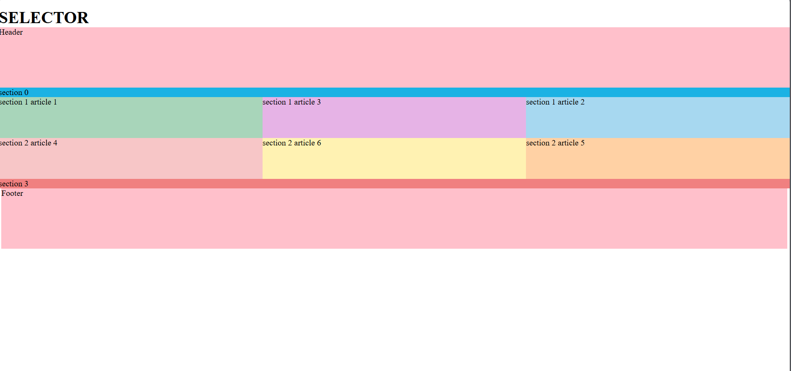

# Day 17 – CSS Selectors, Flexbox, Grid & Cooking Recipe Website

## Topics Covered

- CSS Selectors
- CSS Flexbox
- Flex Wrap
- Hover Effects
- CSS Grid
- CSS Transitions

---

## Task 1 – CSS Selectors and Grid Layout

**Objective:** Create a webpage using HTML and CSS to practice selectors, background colors, and grid layouts.

**Implementation:**
- Created a webpage with a heading, header, sections, content boxes, and footer.
- Applied CSS selectors to style individual HTML elements.
- Used different light background colors for each section and box.
- Arranged content using CSS Grid with three columns.
- Applied dimensions, spacing, and background colors using CSS properties.

**Technologies:** HTML5, CSS3

### Source Files

- [selector.html](selector.html)
- [style.css](style.css)

### Output



---

## Task 2 – Cooking Recipe Website

**Objective:** Develop a multi-page Cooking Recipe Website using HTML, CSS, and JavaScript.

### Features

- Home page displaying different food items.
- Recipes page with ingredients and preparation instructions.
- About page describing the website.
- Contact page with a contact form.
- Login page for existing users.
- Registration page for new users.
- Consistent navigation across all pages.
- CSS Grid and Flexbox for arranging content.
- Hover effects and transitions for interactive elements.
- Responsive layouts using Flexbox, Grid, and flexible sizing without media queries.

### Technologies Used

HTML5, CSS3, JavaScript

### Project Structure

```text
Day-17/
│
├── Cooking-Recipes/
│   ├── about.html
│   ├── contact.html
│   ├── index.html
│   ├── login.html
│   ├── recipe.html
│   └── register.html
│
├── image.png
├── readme.md
├── selector.html
└── style.css
```

### Source Files

| Page | Description |
|---|---|
| [Home](Cooking-Recipes/index.html) | Displays available food items |
| [Recipes](Cooking-Recipes/recipe.html) | Ingredients and preparation instructions |
| [About](Cooking-Recipes/about.html) | Information about CookBook |
| [Contact](Cooking-Recipes/contact.html) | Contact form |
| [Login](Cooking-Recipes/login.html) | User login form |
| [Register](Cooking-Recipes/register.html) | User registration form |

---

## Key Learnings

- Understood CSS selectors and class-based styling.
- Practiced Flexbox and `flex-wrap`.
- Learned to arrange elements using CSS Grid.
- Implemented hover effects and CSS transitions.
- Developed a multi-page website using HTML and CSS.
- Applied responsive layout techniques without media queries.
- Improved practical knowledge of frontend development.

## Conclusion

Day 17 provided practical experience with CSS selectors, Flexbox, Grid, hover effects, and transitions. These concepts were applied in creating a CSS layout exercise and a multi-page Cooking Recipe Website.